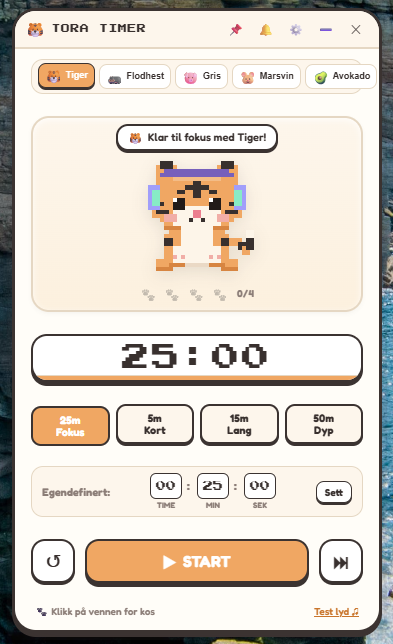

# 🐯 Tiger & Friends Pomodoro Desk Buddy

[](https://opensource.org/licenses/MIT)
[](https://nodejs.org/)
[](#)
[](#)

An adorable, lightweight, standalone desktop Pomodoro timer featuring **5 cozy Pixel Art companions** (Tiger, Hippo, Pig, Guinea Pig, and Avocado). Built as a frameless desk companion widget with procedural animations, custom duration controls (HH:MM:SS), customizable retro soundscapes, multi-language support (English & Norsk), and an **Always-on-Top (📌)** floating pin.

<p align="center">
  
</p>

---

## ✨ Features / Funksjoner

### 🐾 5 Pixel Art Companions / Skrivebordsvenner
100% procedurally rendered on an HTML5 canvas pixel matrix—**zero external image assets required**.
- **🐯 Tiger (Tora)**: Warm orange coat, soft charcoal stripes, and white muzzle.
- **🦛 Hippo / Flodhest (Pippo)**: Pastel lavender-blue chubby buddy with cute nostrils and tiny baby teeth.
- **🐷 Pig / Gris (Nøff)**: Sweet baby pink with floppy folded ears, rosy snout, and a curly tail.
- **🐹 Guinea Pig / Marsvin (Pip)**: Fluffy toffee & cream potato shape, munching on a tiny dandelion leaf snack.
- **🥑 Avocado / Avokado (Avo)**: Dark green skin, creamy lime flesh, a round seed tummy, and a perky leaf on top!

### 🎭 Micro-States & Animations
- **Focus Mode**: Headphones on, rhythmic head bobs, floating musical notes (`♪`, `♫`).
- **Paused Mode**: Curious head tilt, waiting ellipsis, and soft tail twitches.
- **Break Mode**: Sipping a warm cup of cocoa (`^ _ ^`) or cozy slumber.
- **Time's Up**: Celebratory raised paws with bursting colorful confetti and star sparkles!
- **Interactive Pet**: Click on your companion anytime to pet them and watch them wink!

### 🔔 5 Customizable Synthesized Sounds
Procedural Web Audio API sound generator (no external audio files needed):
1. **🔔 Melodic Chime / Klokkespill** (Default): Gentle ascending bells (C5–E5–G5–B5–C6).
2. **🕹️ 8-Bit Retro Arcade**: Upbeat Game Boy victory fanfare.
3. **🪵 Warm Marimba / Kalimba**: Soft, calming wooden acoustic tones.
4. **⏰ Digital Watch Beep**: Nostalgic classic wristwatch alarm (`beep-beep beep-beep`).
5. **✨ Magical Harp**: Twinkling fairy glissando.
- Volume slider (0% to 100%) and instant sound preview button.

### 🌐 Multi-Language Support (i18n)
- **🇳🇴 Norsk (Bokmål)** and **🇬🇧 English** supported.
- Switch languages seamlessly with 1-click in the Settings menu (`⚙️`).
- All tooltips, presets, buttons, speech bubbles, and notifications update in real-time.

### 🎮 Tamagotchi Gamification & Levels
- **XP Progression**: Earn +25 XP per focus session, +10 XP per break, +20 XP for focus tasks, and +5 XP for hydration!
- **5 Levels**:
  - 🌱 **Level 1**: Spire / Sprout
  - 🎓 **Level 2**: Fokuslærling / Focus Apprentice
  - ⚔️ **Level 3**: Fokusridder / Focus Knight
  - 🧘 **Level 4**: Zen Mester / Zen Master
  - 🌟 **Level 5**: Legendarisk Guru / Legendary Guru
- **🔥 Daily Streaks**: Automatically tracks consecutive daily focus streaks.
- **🐾 Pet Counter**: Keeps track of pets, unlocking a special secret accessory at 10 pets!

### 🎩 Unlockable Hats & Accessories
Procedural pixel-art accessories that dynamically bob on all 5 companions:
- ❌ **Ingen / None**: Default look.
- 👑 **Kongekrone / Golden Crown**: Unlocks at Level 2.
- 🧙‍♂️ **Trollmannshatt / Starry Wizard Hat**: Unlocks at Level 3.
- 🕶️ **Solbriller / Pixel Sunglasses**: Unlocks at Level 4.
- 🌸 **Blomsterkrans / Flower Crown**: Unlocks at Level 5.
- 🎀 **Rød Sløyfe / Red Bow**: Secret accessory unlocked by petting your buddy 10 times!

### 🌧️ Procedural Ambient Soundscapes
Relaxing background audio synthesized live in Web Audio API with independent volume controls:
- 🌧️ **Mildt Regn / Gentle Rain**: Soft pink noise through dual acoustic filters.
- 🔥 **Knitrende Peis / Campfire**: Warm low-frequency drone with randomized crackle bursts.
- 🍃 **Skogsbris / Forest Breeze**: Swaying resonant wind with slow LFO modulation.
- ☕ **Koselig Kafé / Cozy Cafe**: Soft acoustic chatter drone and ambient frequencies.

### 🎯 Mini Focus Task Banner
- Editable banner right above your companion: *"Hva fokuserer du på akkurat nå?"*
- One-click checkmark (`✓ Ferdig`) to complete your task, celebrate with confetti, and claim **+20 XP**!

### 🏡 4 Cozy Room Themes
- ☀️ **Koselig Dag / Cozy Day**: Classic warm beige and pastel cream.
- 🌙 **Stjerneklar Natt / Starry Night**: True OLED-friendly dark mode with midnight blues.
- 🌸 **Kirsebærlund / Sakura Blossom**: Pastel pink floral aesthetic.
- 🪴 **Botanisk Drivhus / Botanical Oasis**: Calming matcha and greenhouse foliage greens.

### 🗗 Ultra-Compact Floating Mini-Widget Mode (240x72 px)
- Toggle anytime via the **`🗗`** button on the title bar.
- Shrinks the app into a sleek 240x72 px desk ticker showing your companion's bobbing head, digital countdown, and mini play/pause control.
- Automatically stays on top and is 100% draggable from anywhere on the widget!
- Click **`🗖`** to restore to full desk buddy view anytime.

### 💧 Gentle Hydration Reminders
- Gentle reminder speech bubble every 2 focus sessions. Click the companion to take a sip and earn +5 XP!

### ⏱️ Flexible Countdown & Presets
- **Manual Input (HH : MM : SS)**: Set any custom hours, minutes, and seconds.
- **Quick Presets**: 25m Focus, 5m Short Break, 15m Long Break, 50m Deep Work.
- **Controls**: Start ▶, Pause ⏸, Reset ↺, Skip ⏭.
- **Session Tracker**: 4 cute paw markers (`🐾 🐾 ⚪ ⚪`) keep track of your focus sets.

### 📌 Desktop Widget Mode
- **Borderless / Frameless Window**: Clean, rounded pastel aesthetic.
- **Always on Top (📌)**: Pin the timer so it floats over your IDE, browser, or documents.
- **Draggable Window**: Click and drag anywhere on the header to move the widget.

---

## 🚀 How to Run the App / Hvordan kjøre appen

### Option 1: 1-Click Launch (Windows)
Double-click the **`run.bat`** file in the project folder.

### Option 2: Run via Terminal (Node.js & Electron)
```bash
# 1. Install dependencies (only needed the first time)
npm install

# 2. Start the application
npm start
```

### Option 3: Standalone Zero-Dependency Python Script
Run with Python's built-in standard library (`tkinter`):
```bash
python tiger_pomodoro.py
```

---

## 📦 How to Package into an Executable (.exe)

### Windows Executable (.exe):
- **1-Click**: Double-click **`build-exe.bat`**.
- **Or via Terminal**:
  ```bash
  npm run build:exe
  ```
The standalone single-file executable will be generated inside the `dist/` directory:
- `dist/Tiger-Pomodoro-Windows.exe` (Runs on any Windows PC without installation!)

### macOS (.app) or Linux:
```bash
# macOS
npx electron-builder --mac

# Linux
npx electron-builder --linux
```

---

## 🛡️ Security & Privacy (Sikkerhet)

This project has been configured with strict privacy and security practices:
- **No hardcoded secrets or personal paths**: Source files contain zero API keys, passwords, or personal credentials.
- **Comprehensive `.gitignore`**: Automatically prevents committing build folders (`dist/`), packages (`node_modules/`), system caches, logs, or `.env` files to GitHub.
- **100% Offline & Procedural**: All pixel art and sounds are generated locally in code without external network dependencies.

---

## 🐙 Publishing to GitHub (Steg-for-steg for nybegynnere)

Hvis du aldri har lagt ut noe på GitHub før, følg denne enkle veiledningen:

### Metode 1: Via GitHub Desktop (Anbefalt og enklest!)
1. Last ned og installer gratisprogrammet **[GitHub Desktop](https://desktop.github.com/)**.
2. Logg inn med din GitHub-konto (eller lag en gratis konto på [github.com](https://github.com)).
3. I GitHub Desktop: Velg **File** ➔ **Add Local Repository**.
4. Velg mappen til prosjektet (`c:\AI prosjekter\pomodoro`).
5. Hvis den spør om å lage et repository, trykk **Create a Repository**.
6. Trykk på den blå knappen **Publish repository** øverst.
   - Velg et navn (f.eks. `tiger-pomodoro`).
   - Huk av eller på *Keep this code private* (avhuket = offentlig for alle).
7. Trykk **Publish repository**.
8. **Ferdig!** `.gitignore` sørger automatisk for at kun de rene kildekodefilene lastes opp – ingen tunge `node_modules` eller `.exe`-filer blir lastet opp til koden.

---

### Metode 2: Via Git i Terminal
1. Installer Git fra **[git-scm.com](https://git-scm.com/)**.
2. Åpne [github.com](https://github.com) og trykk **New Repository** (la "Add README" og "Add .gitignore" være **uhuket**, da vi allerede har disse filene lokalt).
3. Åpne terminalen i prosjektmappen og kjør:
   ```bash
   git init
   git add .
   git commit -m "Initial commit: Tiger & Friends Pomodoro"
   git branch -M main
   git remote add origin https://github.com/DITT-BRUKERNAVN/DITT-REPO-NAVN.git
   git push -u origin main
   ```

---

## 📂 Project Architecture

```
pomodoro/
├── package.json              # Electron & build configuration
├── main.js                   # Frameless window manager, IPC & desktop notifications
├── preload.js                # Secure context bridge between Electron and UI
├── run.bat                   # 1-click Windows launcher
├── build-exe.bat             # 1-click Windows executable builder
├── tiger_pomodoro.py         # Standalone Python Tkinter alternative
├── .gitignore                # Protects sensitive files, node_modules & dist/
├── LICENSE                   # Open-source MIT License
├── README.md                 # Documentation in English & Norwegian
└── src/
    ├── index.html            # UI layout: custom frame, stage, timer, controls, modal
    ├── styles.css            # Pastel aesthetic, pixel typography & animations
    ├── i18n.js               # Multi-language translation engine (Norsk & English)
    ├── tiger.js              # Pixel art companion procedural canvas (5 skins)
    ├── audio.js              # Web Audio API sound synthesizer (5 alert sounds)
    ├── timer.js              # Pomodoro timer engine (presets, countdown, sessions)
    └── app.js                # Application coordinator & event bindings
```

---

## 📄 License
This project is licensed under the [MIT License](LICENSE).
